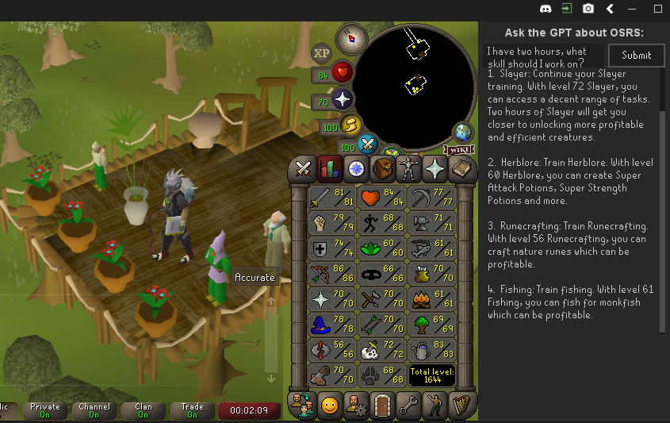
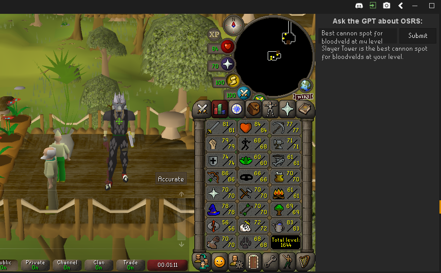

# 🧠 RuneGPT

    

Ask Gemini, Claude or Groq about Old School RuneScape (OSRS) using your current player stats and bank items!

## 🚀 Features
- 🖥️ Easy-to-Use Panel: Ask questions directly from RuneLite’s sidebar.
- ⚙️ Configurable: Securely enter and store your Gemini API key via RuneLite’s plugin settings.
- 📊 Stats: User stats are automatically accounted for to cater for every unique request.

### UPCOMING:
- 🛡️ Context-Aware: Queries include your bank items for tailored suggestions.
- ⚔️🤺 Combat Items: Bring the best items you got for the fight! 
- 🔹 Markdown-Style Display: View responses in a clean, markdown-styled panel with headings, lists, and bold highlights.
- 🔌 Wiki Integration: Suggestions will reflect up-to-date guides
- 🔌 GE Integration: Some responses will have real-time prices (Will require osrs API key)
### Showcase
Questions about stats and quests integrated into plugin.

## 🛠️ Setup
1. Install the Plugin:
    - Add the plugin via the RuneLite Plugin Hub.
    - Enable RuneGPT from the RuneLite settings.

2. Enter Your API Key (BYOK – Bring Your Own Key):

You must bring your own API key for Gemini (Google). This plugin does not provide one.

Why?

- 💳 API keys are tied to your Google account. (OpenAI upcoming)
- 🚫 This plugin does not store or share your key. It stays local on your machine.

🔑 How to Add Your API Key:
- Go to Google [AI Studio](https://aistudio.google.com/app/apikey), click `Get API Key` and copy the key you just created
- In RuneLite, go to Configuration (🛠️ wrench icon).
- Find RuneGPT Plugin under settings.
- Enter your Google Gemini API Key.

🤖 Other providers (add as many keys as you like):
- **Claude**: create a key at the [Anthropic Console](https://console.anthropic.com/settings/keys) and paste it into **Claude API Key**. Optionally change **Claude Model** (default `claude-opus-5-5`; `claude-sonnet-5-5` or `claude-haiku-5-5` are cheaper).
- **Groq (free, no card)**: create a key at the [Groq Console](https://console.groq.com/keys) and paste it into **Groq API Key**. The default model is `openai/gpt-oss-120b`.

🔁 Automatic failover:
- **Primary LLM Provider** is tried first. If it errors or runs out of tokens, RuneGPT moves on to the next provider that has a key, without you doing anything.
- Your conversation is kept inside the plugin, so whichever provider answers can see the earlier messages. Use **Clear** in the panel to start a new conversation.
- You only see an error once every configured provider has failed.

## ✨ Usage

- Open the RuneGPT Panel from the sidebar.
- The panel shows a status line (which AI provider is connected), the **chat** on top and collapsible **sections** below: Quest Helper, Combat & Slayer, Boss Prep, Skill Trainer, Money Maker and Minigames. Drag the divider to give the chat or the sections more room.
- Each section suggests guides based on your stats, gear and quest progress. Press **Ask** for a one-click answer, or click a guide's title to pick optional preferences (attack style, gear budget, fastest/cheapest/AFK) first.
    - **Edit guide** lets you change its details (e.g. the monster or kill count) or rewrite the whole question. Edits are saved; **Reset to default** undoes them.
    - **Something else?** at the bottom of each section lets you type your own interest.
- **Quest helper** (Continue *quest* / Quest helper: *quest*): checks the quest really exists, reads its guide from the [OSRS Wiki](https://oldschool.runescape.wiki), then shows where you likely are, the next step, and a checklist of required items marked against your inventory, worn items and bank (open your bank once per session so it can be checked). **Highlight** puts an arrow, outline and a line to the NPC in-game when they're nearby. Anything the AI suggests that the wiki guide doesn't mention is hidden.
- **Track guide**: answers that describe an activity (a boss, monster, skill method, quest step...) come with a checklist of gear to wear and items to bring, plus where to go. Press **Track guide** to pin it:
    - The checklist updates live as your inventory, equipment and bank change: **green** = ready, **yellow** = in your inventory but needs equipping, **red** = missing or still in the bank.
    - An in-game overlay shows the same checklist with distance and direction to the target (toggle it with *Show guide checklist in game*).
    - The target gets a world map marker (orange = OSRS Wiki coordinates, grey = AI estimate), plus a hint arrow, outline and line to the NPC or spot when you're nearby.
    - Every item, NPC and place is checked against the OSRS Wiki first; anything that doesn't exist is dropped.
- Answers are formatted for the narrow sidebar: wide tables become stacked lists and stray HTML is stripped.
- Or just type a question like:
    - "What’s the best setup for Barrows with my stats?"
    - "Whats the best way to level my agility?"
    - "Whats a good money making method basded on my stats?"
    - "Can I solo Zulrah with my current gear?" (upcoming)

## 🛡️ Security

- Your API key is stored locally via RuneLite’s secure configuration.
- No keys or data are sent anywhere except directly to the LLM provider.

## 💸 Costs

This plugin uses Google Gemini API, which currently offers free API access with generous usage limits. Check Google's terms for any updates on usage policies.
### Note: OpenAI and others require you to add a payment method whereas Google does not. This was the main factor in picking the service.

#### No, RuneGPT isn’t a true GPT model since it isn’t pre-trained. The name was chosen more for fun, though the project could eventually head in that direction.
