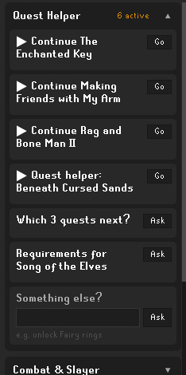
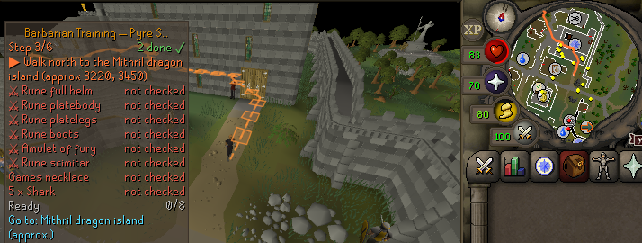
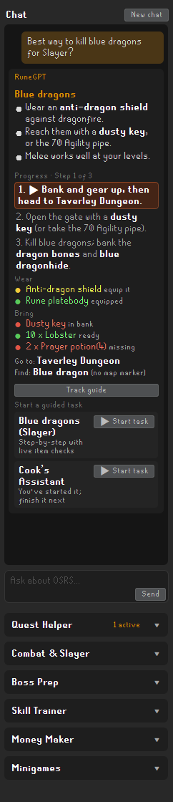
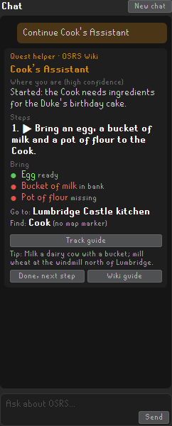
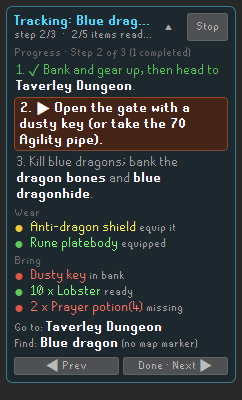
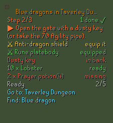

# 🧠 RuneGPT

An AI assistant for Old School RuneScape in RuneLite's sidebar. Ask about quests, bosses, skilling or money making and get short, tactical answers tailored to your account, with guides checked against the OSRS Wiki and a live item checklist you can track in game.

## 🚀 Features
- 🖥️ **Chat + guide sections**: ask anything, or pick a suggested guide (Quest Helper, Combat & Slayer, Boss Prep, Skill Trainer, Money Maker, Minigames) with one click. Answers appear as they're written.
- 📊 **Knows your account**: stats, quest progress, gear and your bank (remembered once you've opened it) are included automatically.
- 📜 **Wiki-checked**: quest steps come from the OSRS Wiki, and items, NPCs and places are checked against it before you see them.
- ✅ **Track guide**: a live checklist (green = ready, yellow = equip it, red = missing / in bank), step-by-step progress, an in-game overlay, a world map marker, and a walkable path to the NPC or spot when you're nearby.
- 🔁 **Failover**: add more than one key and RuneGPT switches provider automatically if one fails or runs out of tokens.

### Showcase

In game:

<table>
  <tr>
    <td align="center" valign="top"> Quest Helper picks up your quests in progress</td>
    <td align="center" valign="top"> Tracked guide: checklist overlay, walkable path and minimap route</td>
  </tr>
</table>

Panels and overlay:

<table>
  <tr>
    <td align="center" valign="top"> Answer, checklist and guided tasks</td>
    <td align="center" valign="top"> Wiki-grounded quest helper</td>
  </tr>
  <tr>
    <td align="center" valign="top"> Tracked guide with step progress</td>
    <td align="center" valign="top"> In-game checklist overlay</td>
  </tr>
</table>

## 🛠️ Setup

1. **Install the plugin** from the RuneLite Plugin Hub and enable it.

2. **Add an API key** (Configuration 🛠️ → RuneGPT → *AI providers*). Add any of these; more than one gives automatic failover:
    - **Groq** (free, no card): create a key at the [Groq Console](https://console.groq.com/keys) and paste it into **Groq API Key**. Default model `openai/gpt-oss-120b`.
    - **Gemini**: get a key from Google [AI Studio](https://aistudio.google.com/app/apikey) (`Get API Key`) and paste it into **Gemini API Key**.
    - **Claude**: create a key at the [Anthropic Console](https://console.anthropic.com/settings/keys) and paste it into **Claude API Key**. Optionally change **Claude Model** (default `claude-opus-5-5`; `claude-sonnet-5-5` or `claude-haiku-5-5` are cheaper).

    **Primary LLM Provider** is tried first; if it errors or runs out of tokens, the others with a key are tried automatically. You only see an error if none of them can answer, or if no key is set.

3. **Optional: free starter service (no key).** To try RuneGPT without any key, turn on *Free starter service → Use free starter service*. It's **off by default**. It uses the keyless [Pollinations](https://pollinations.ai) service, which is slow, limited to about one reply every 45 seconds, and often inaccurate. When it's on, your questions and player data are sent to that free third-party service. With keys set, it's only used after your providers.

## ✨ Usage

- Open the RuneGPT panel from the sidebar: the **chat** is on top and the collapsible guide **sections** are below. Drag the divider to give either more room.
- Each section suggests guides based on your stats, gear and quest progress. Press **Ask** for a one-click answer, or click a guide's title to pick optional preferences (attack style, gear budget, fastest/cheapest/AFK) first.
    - **Edit guide** changes its details (e.g. the monster or kill count) or rewrites the whole question. Edits are saved; **Reset to default** undoes them.
    - **Something else?** at the bottom of each section lets you type your own interest.
- **Quest helper** (Continue *quest* / Quest helper: *quest*): checks the quest really exists, reads its guide from the [OSRS Wiki](https://oldschool.runescape.wiki), then shows where you likely are, the next steps, and the items you need. Anything the AI suggests that the wiki guide doesn't mention is hidden. Press **Done, next step** as you go.
- **Guided tasks**: answers can suggest quests, minigames, money makers, bosses or skilling methods with a **Start task** button, which walks you through them step by step. Completed quests and skill goals you've already reached aren't suggested.
- **Gear optimizer** (Best gear I own for *monster* / *boss*): compares Melee, Ranged and Magic against the monster's defences, weakness and attributes from the [OSRS Wiki](https://oldschool.runescape.wiki) using the gear you actually have worn, in your inventory and in your bank, and filters out items your levels can't equip yet. Press **Track setup** to pin the winning loadout to the live checklist and in-game overlay.
- **Live GE prices**: item prices in answers and guide checklists come from RuneLite's live Grand Exchange price data (with a missing-items cost total on checklists), so the AI never guesses GP numbers.
- **Account type**: RuneGPT reads whether you're a normal account or an Ironman, Hardcore, Ultimate or Group Ironman. Ironmen aren't told to buy from the GE or trade, Ultimate Ironmen aren't told to bank, and Hardcore answers about deadly content start with a risk warning. The detected type is shown above the guide sections.
- **Track guide**: answers that describe an activity (a boss, monster, skill method, quest step...) come with a checklist of gear to wear and items to bring, plus where to go. Press **Track guide** to pin it:
    - The checklist updates live as your inventory, equipment and bank change: **green** = ready, **yellow** = in your inventory but needs equipping, **red** = missing or still in the bank, **grey** ("check bank") = not on you and RuneGPT hasn't seen your bank yet.
    - An in-game overlay shows the same checklist with distance and direction (toggle it with *In-game → Show guide checklist in game*).
    - The pinned panel shows done steps in green and the current step in orange; use **Prev** / **Next** or click a step to move.
    - The target gets a world map marker (cyan = OSRS Wiki coordinates, grey = AI estimate) and a minimap arrow with the distance. When you're nearby, the NPC or spot is outlined, with a hint arrow and a walkable path that goes around buildings and through doors.
    - **Works with [Shortest Path](https://runelite.net/plugin-hub/show/shortest-path):** if you have that Plugin Hub plugin, RuneGPT sends it the destination (OSRS Wiki coordinates only), so it draws the full route with teleports and transports using your Shortest Path settings. RuneGPT clears the route when you stop tracking, but never a path you set yourself. Turn this off with *In-game → Route with Shortest Path plugin*.
- Ask follow-ups in the chat; **New chat** starts over. Answers are formatted for the narrow sidebar.
- Or just type a question like:
    - "What's the best setup for Barrows with my stats?"
    - "What's the best way to level my Agility?"
    - "What's a good money making method for my stats?"

## 🔒 Data & privacy

RuneGPT sends data off your computer only to do what you ask:

| What | Where it goes |
|---|---|
| Your questions, account type (e.g. Ironman), skill levels, quest progress, inventory, worn items, bank contents (once you've opened your bank; see below) and location | The AI provider(s) you added a key for: Google Gemini, Anthropic Claude and/or Groq |
| The same data, **only if you turn on the free starter service** | Pollinations (text.pollinations.ai), a free third-party service |
| Quest, item, NPC and place names | The [OSRS Wiki](https://oldschool.runescape.wiki), to fetch guides and check that things exist |

- API keys are **encrypted** (AES-256-GCM) before they're saved in your RuneLite settings, so synced RuneLite profiles and copied profile files never contain a usable key. The decryption key is created on first use and kept only on your computer in `~/.runelite/runegpt/secret.key`; it is never synced. On a new computer, re-enter your keys once.
- Keys are only decrypted in memory when a request is sent, and only sent to their own provider.
- Limitation: software running under your own computer account could read both files and decrypt the keys. Protecting against that would need your operating system's credential store, which RuneLite plugins can't rely on.
- Your conversation is kept in memory while the plugin runs and cleared when it stops.
- **Bank memory:** so RuneGPT knows your bank before you open it, your last-seen bank (item ids and quantities only) is saved on your computer in `~/.runelite/runegpt/`, one file per account named by RuneLite's numeric account ID (not your username). It is never synced or uploaded; it's only sent to your AI provider as part of a question, like a freshly opened bank. Turn off *In-game → Remember bank between sessions* to stop this and delete the saved copies.
- Each provider's own privacy policy applies to what you send it.

## 💸 Costs

- **Groq** has a free tier with no card required, which is the easiest way to start.
- **Gemini** offers free API access with usage limits; check Google's terms for current limits.
- **Claude** is paid per use.
- The optional starter service is free but heavily rate-limited.

#### No, RuneGPT isn't a true GPT model since it isn't pre-trained.
